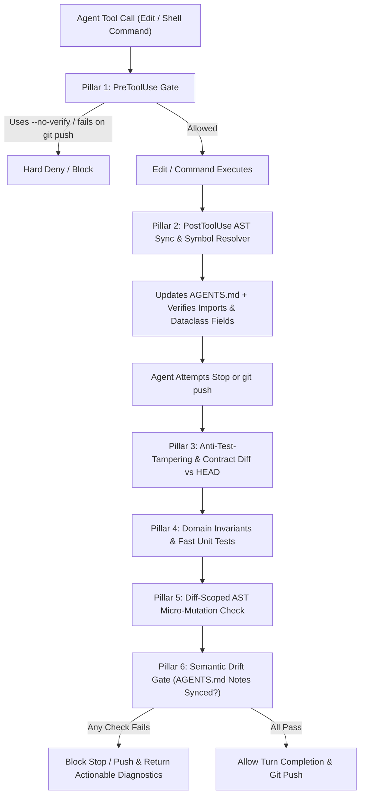

# `ai-native-repo` — Real-Time Context & Zero-Collateral Verification Engine (v3.0)

Turn any repository into a **self-updating, guardrail-enforced codebase** built for autonomous AI software engineers (**Antigravity**, **Claude Code**, **Cursor**, **Codex**, and **Gemini CLI**).

**Zero external dependencies** (pure Python 3 stdlib). **Zero manual doc maintenance.** **Zero silent agent regressions.**

---

## Why `ai-native-repo`? (Benefits & Problem Solved)

Human docs and traditional unit tests break down when AI agents write code autonomously:
1. Documentation rots on the first edit, or floods context windows if kept in one giant file.
2. Agents share blind spots with the tests they write (the **"Tautology Trap"**), hallucinate symbols in unexecuted branches, or cause collateral damage across layers.
3. Under outcome pressure (*"make tests pass"*), agents can **reward-hack** by weakening assertions, skipping failing tests, or running `git commit --no-verify`.

### Before vs. After

| Dimension | Traditional Repo | With `ai-native-repo` v3.0 |
| :--- | :--- | :--- |
| **Agent Onboarding** | New agent wastes 5–15 tool calls grepping files to understand layout & rules. | Agent reads lean root `AGENTS.md` (<200 lines) + scoped layer `AGENTS.md` immediately. |
| **Doc Freshness** | Function signatures, dataclasses, and module maps go stale immediately. | `PostToolUse` hook + `.githooks/pre-commit` re-sync `<!-- AUTO-GENERATED -->` contracts from AST in `<50ms`. |
| **Hallucinations & Stubs** | Unexecuted branches hide hallucinated imports, wrong dataclass fields, or `NotImplementedError` stubs. | Cross-module AST resolver checks every internal `from ... import ...` and `@dataclass(...)` keyword argument statically. |
| **Collateral Damage & Test Tampering** | Agent deletes a failing test, skips assertions, drops a model field, or uses `--no-verify`. | `PreToolUse` blocks `--no-verify` & unverified pushes; `verify_architecture.py` blocks test weakening & removed dataclass fields vs `HEAD`. |
| **Weak / Tautological Tests** | Agent writes trivial tests that pass even if logic is broken. | **Diff-scoped AST micro-mutation testing** mutates changed conditions (`==` ↔ `!=`, `True` ↔ `False`) and fails if tests don't kill the mutant. |
| **Architectural Memory & Handoffs** | Next agent undoes hidden invariants or leaves without documenting changes. | Machine-readable ADRs (`docs/adr/*.md`) route into matching `AGENTS.md` files, and `Stop` gate blocks semantic drift. |

---

## The 6-Pillar Zero-Collateral Verification Architecture



---

## How to Onboard Any Repository

### Step 1: One-Time Global Plugin Install

**Option A — Ask Your AI Agent (Antigravity / Claude Code / Cursor):**
> *"Install `ai-native-repo` from `https://github.com/njindal96/ai-native-repo` using `install.sh`."*

**Option B — 1-Line Terminal Install (Humans):**
```bash
curl -fsSL https://raw.githubusercontent.com/njindal96/ai-native-repo/main/install.sh | bash
```

---

### Step 2: Bootstrap Any New or Existing Repository

Choose whichever option fits your workflow:

1. **Via AI Agent (Recommended):**
   Open your target repo in Antigravity (or another agent) and ask:
   > *"Initialize AI-native setup in this repo."*
2. **Via 1-Line Terminal Command (Install + Bootstrap Together):**
   ```bash
   curl -fsSL https://raw.githubusercontent.com/njindal96/ai-native-repo/main/install.sh | bash -s -- --init /path/to/your-repo
   ```
3. **Via Direct Python Command (Already Installed):**
   ```bash
   python3 ~/.gemini/config/plugins/ai-native-repo/scripts/bootstrap_repo.py --workspace /path/to/your-repo
   ```

---

### Step 3: What Gets Created in Your Repository

`bootstrap_repo.py` is **non-destructive** and scaffolds:

```text
your-repo/
├── .ai-native.json               # Layer rules, context budgets, contract compatibility & mutation gates
├── AGENTS.md                     # Lean (<200 lines) global map, Always/Ask First/Never tiers & live index
├── CLAUDE.md -> AGENTS.md        # Symlink so Claude Code & Cursor read the exact same context
├── docs/adr/
│   └── 001-ai-native-architecture.md  # Starter machine-readable ADR (YAML frontmatter routed)
├── scripts/
│   ├── sync_context.py           # Portable polyglot AST + ADR introspector
│   └── verify_architecture.py    # Portable v3.0 verifier (boundaries, hallucinations, regressions, mutations)
└── .githooks/
    ├── pre-commit                # Auto-syncs AGENTS.md + runs verify_architecture.py before every commit
    └── pre-push                  # Runs full verify_architecture.py before every git push
```
Plus a scoped `AGENTS.md` inside each auto-detected code directory (e.g., `app/domain/AGENTS.md`, `app/services/AGENTS.md`).

---

### Step 4: Optional 2-Minute Customization (High Leverage)

1. **Tighten Layer Boundaries & Blast Radius in `.ai-native.json`:**
   ```json
   {
     "version": "3.0",
     "context_budget": { "max_lines": 200, "max_bytes": 20000 },
     "test_command": "python3 -m unittest discover -s tests -p 'test_*.py'",
     "enforce_contract_compatibility": true,
     "mutation_testing": true,
     "max_layers_touched": 3,
     "layers": [
       {
         "path": "app/domain",
         "allowed_internal_prefixes": ["app.domain"],
         "forbidden_imports": ["requests", "sqlalchemy", "app.services"],
         "reason": "Domain layer must remain pure business logic."
       }
     ]
   }
   ```
2. **Add Machine-Readable ADRs (`docs/adr/002-my-invariant.md`):**
   ```markdown
   ---
   id: ADR-002
   title: Never Bypass Payment Idempotency Keys
   status: accepted
   applies_to: app/services/*
   summary: All billing endpoints must pass an idempotency_key header; never retry blindly.
   ---
   ```
3. **Commit the Onboarded Files:**
   ```bash
   git add .ai-native.json AGENTS.md CLAUDE.md docs/adr/ scripts/ .githooks/ && git commit -m "Onboard repo to ai-native-repo v3.0"
   ```

---

## How It Works Day-to-Day (Zero-Touch Lifecycle)

Once onboarded, **no special prompt or command is needed** when a new agent starts work:

1. **Arrival:** `rules/AGENTS.md` + root `AGENTS.md` (`CLAUDE.md`) give the agent the system map, action tiers, and ADR index.
2. **Navigation:** Opening a subfolder surfaces its scoped `AGENTS.md` with live contracts, internal imports, and governing ADRs.
3. **Editing (`PostToolUse`):** `sync_context.py` immediately updates `AGENTS.md` on disk.
4. **Shell Gates (`PreToolUse`):** `--no-verify` is blocked; `git push` triggers full `verify_architecture.py`.
5. **Completion (`Stop` Gate) & Git Hooks:** `verify_architecture.py` checks syntax, hallucinations, layer boundaries, test tampering, contract regressions, context budgets, unit tests, and diff-scoped AST mutations, while `stop_gate_hook.py` blocks exit if semantic `AGENTS.md` prose wasn't updated after a contract change.

## License
MIT License — see [LICENSE](LICENSE).
